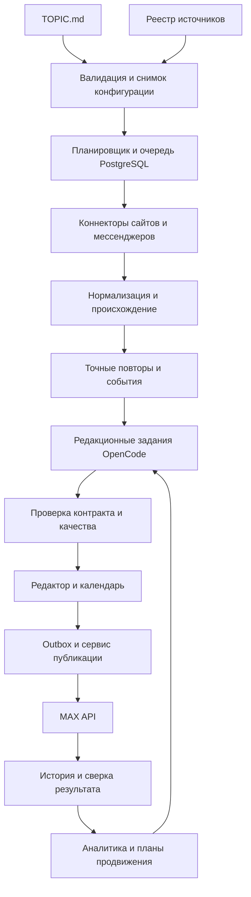

# Архитектура агента каналов MAX

Сервис хранит данные и управляет внешними действиями; OpenCode выполняет ограниченные редакционные задания. Такая граница позволяет восстанавливать работу, проверять разрешения и переносить систему без зависимости от состояния одного диалога модели.

## Поток данных



## Компоненты

| Компонент | Ответственность | Состояние |
| --- | --- | --- |
| API и панель FastAPI | Авторизация, каналы, редактор, конфигурации, отчёты | PostgreSQL |
| Config service | TOPIC.md, схемы, версия и активация | ConfigVersion |
| Scheduler | Задания с due_at, misfire, блокировки | Job, SourceCursor |
| Collector workers | RSS, HTML, Telegram события, MAX чтение | Material, RawBlob |
| Content service | Нормализация, хеши, объединение событий | Story, StoryMaterial |
| OpenCode adapter | Создание изолированного задания, ответ, отмена, учёт затрат | GenerationRun |
| Quality service | Факты, ограничения, источники, длина, повторы | QualityCheck |
| Publisher | Единственное место отправки и внешней правки | PublicationIntent, Attempt |
| Webhook ingress | Проверка подлинности и постоянная запись входящих событий | InboxEvent |
| Analytics | Агрегаты контента, аудитории и экономики | MetricSnapshot, Campaign |

База PostgreSQL служит единственным источником истины. Задания выбираются транзакционно через `FOR UPDATE SKIP LOCKED`. Для источника и канала используются отдельные lease с heartbeat и fencing token. Не добавлять Redis или Qdrant как обязательные зависимости первой версии. Хеши и признаки текстов хранить в базе; embeddings можно добавить за интерфейсом после проверки пользы.

## Исполнение редакционных заданий

Роли аналитика, переводчика, автора и проверяющего являются типами заданий. Им не нужны одновременно работающие самостоятельные агенты. Начальная реализация последовательная; увеличение параллелизма требует лимита бюджета и проверки блокировок.

Для каждого задания сервис формирует task_context, снимок темы, выбранные материалы и историю релевантных событий. Новый ограниченный контекст защищает от роста бесконечного диалога. OpenCode запускается с отдельной конфигурацией и хранилищем проекта; токен MAX туда не передаётся.

OpenCode adapter привязан к фактически принятому интерфейсу 2.0.17. API за адаптером можно заменить на другой проверенный транспорт той же версии. SDK V1 не предполагается совместимым. Снимок OpenAPI и контрактные тесты включаются в поставку. Полный тест генерации является условием приёмки адаптера.

## Надёжность

Входящее событие сначала проверяется и записывается в inbox, после commit возвращается подтверждение, далее worker обрабатывает его независимо от HTTP запроса. Стабильный идентификатор события либо документированный отпечаток обеспечивает уникальность.

Черновик после проверок и одобрения создаёт publication intent в outbox в одной транзакции. Worker проверяет актуальность политики, pause, лимит, слот и права непосредственно перед отправкой. Результат API, внешний ID и attempt сохраняются. Падение между HTTP отправкой и записью результата переводит незавершённый intent в unknown и запускает сверку.

Lease сам по себе не отменяет уже отправленный запрос. При потере lease выполнявшаяся внешняя отправка считается неопределённой, пока сверка не докажет исход. Новый worker не отправляет тот же intent автоматически.

## Границы доступа

Сборщикам разрешены зарегистрированные адреса; private IP, loopback, link local и metadata endpoints заблокированы, включая редиректы и повторное разрешение DNS. Вложения проверяются по типу и размеру. OpenCode не получает shell, публикационные инструменты и чтение secrets. Runtime policy проверяется тестом, а изоляция контейнера ограничивает доступ к файловой системе и сети.

Publisher имеет токен только соответствующего канала или bot account. Владелец управляет разрешёнными действиями; редактор одобряет контент; viewer читает отчёты. Панель не выдаёт значения токенов. Webhook публичен только за HTTPS ingress; база и OpenCode остаются во внутренней сети.

## Структура будущего кода

```text
src/max_channel_agent/
  api/             auth, панель, управление
  config/          схемы, снимки, активация
  collectors/      интерфейс, rss, html, telegram, max
  content/         нормализация, дедупликация, события
  editorial/       OpenCode адаптер, задания, проверки
  publishing/      outbox, отправка, сверка, исправления
  growth/          кампании, медиакит, экономика
  jobs/            scheduler, leases, retries
  storage/         модели, репозитории, blobs
  observability/   логи, метрики, health
migrations/
tests/{unit,contract,integration,e2e}/
deployment/
scripts/
```

Это проектная структура, а не перечень уже существующих модулей. Точные контракты находятся в [CONTRACTS.md](CONTRACTS.md), состояние — в [DATA_MODEL.md](DATA_MODEL.md).
